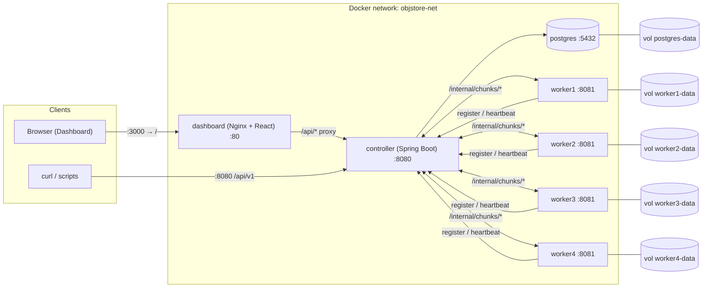
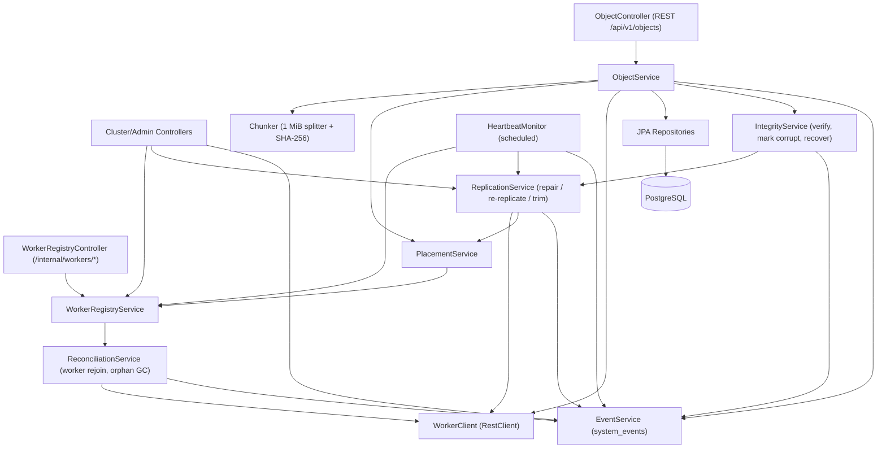
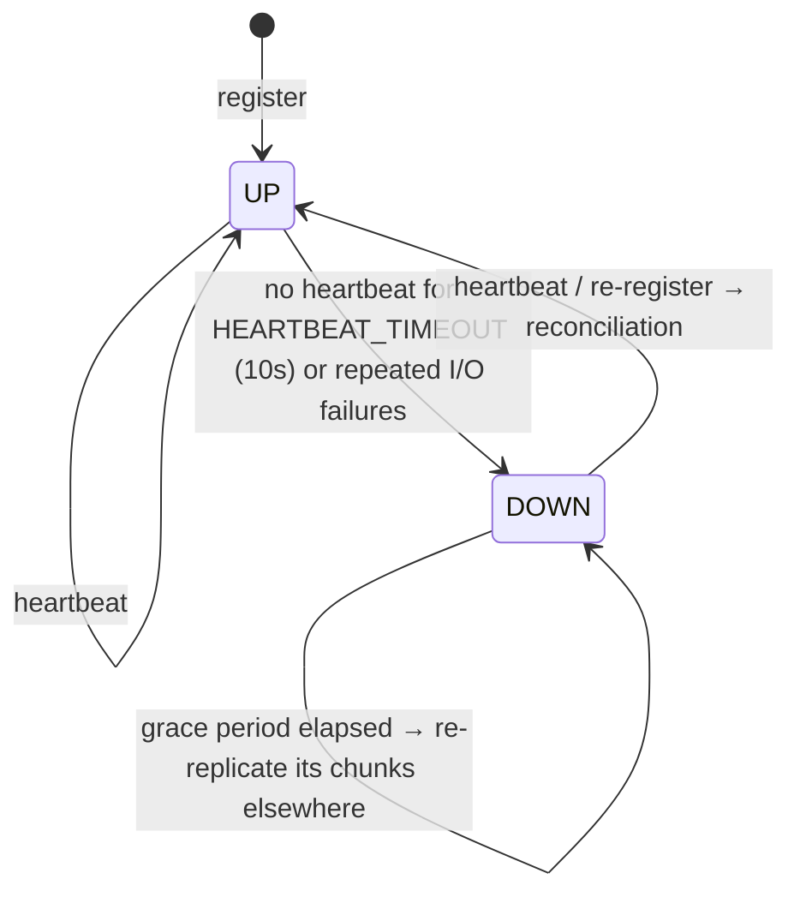
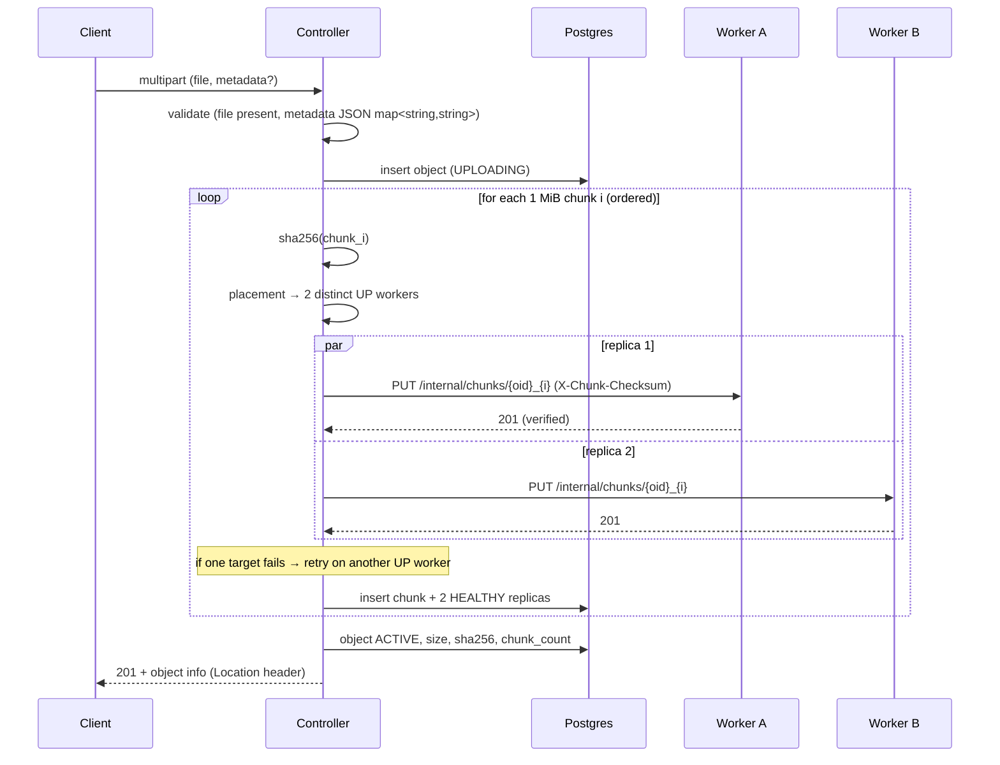
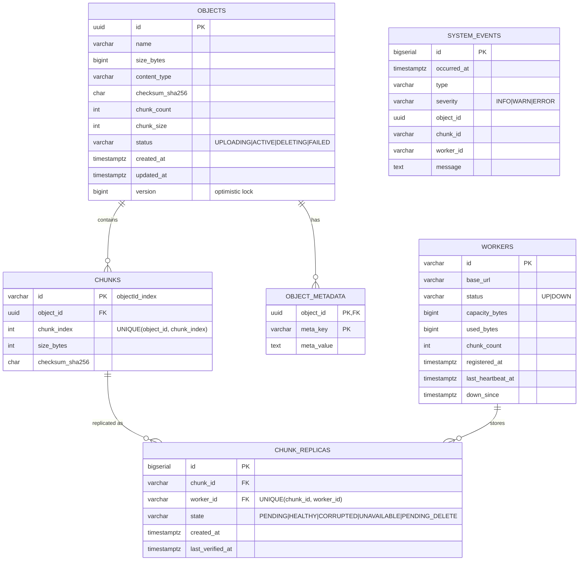

# Mini Distributed Cloud Object Store — Architecture & Implementation Plan

> **Status:** Phase 9 (Dashboard Integration) — **Completed**. Next up: Phase 10 (Comprehensive Testing & Demo Scripts).
> **Source of truth:** `Mini_Distributed_Cloud_Object_Store.pdf` (repository root). Section numbers below (e.g. **§5.1**) refer to that PDF.

---

## Table of Contents

1. [Project Overview](#1-project-overview)
2. [Mandatory Requirements Traceability](#2-mandatory-requirements-traceability)
3. [Design Decisions & Ambiguities](#3-design-decisions--ambiguities-review-required)
4. [Technology Stack](#4-technology-stack)
5. [System Architecture](#5-system-architecture)
6. [Core Workflows](#6-core-workflows)
7. [Folder Structure](#7-folder-structure)
8. [API Specifications](#8-api-specifications)
9. [Database Schema](#9-database-schema-controller-metadata-store)
10. [Worker On-Disk Storage Layout](#10-worker-on-disk-storage-layout)
11. [Configuration (Environment Variables)](#11-configuration-environment-variables)
12. [Implementation Phases & Task Breakdown](#12-implementation-phases--task-breakdown)
13. [Testing Strategy](#13-testing-strategy)
14. [Demonstration Scenarios](#14-demonstration-scenarios-pdf-10)
15. [Risks & Known Constraints](#15-risks--known-constraints)
16. [Completion Checklist](#16-completion-checklist)
17. [Progress Log](#17-progress-log)

---

## 1. Project Overview

A distributed object store built from **1 Controller** and **4 independent Storage Workers**, deployable locally via **Docker Compose** (no Kubernetes). Clients upload arbitrary binary objects to the Controller through a REST API. The Controller:

- splits each object into **exactly 1 MiB (1,048,576 byte) chunks** (final chunk may be smaller),
- computes a **SHA-256** checksum per chunk and for the whole object,
- places **2 replicas of every chunk on 2 different workers**,
- stores all metadata (objects, chunks, replica locations, worker registry, custom metadata) in **PostgreSQL**,
- detects worker failure via **heartbeats**, keeps serving reads from surviving replicas, and **restores the replication factor** when possible,
- detects **corrupted chunks** via checksum verification, never returns corrupted data when a valid copy exists, and **repairs** the bad copy from a valid replica.

Workers are "dumb but honest" storage nodes: they persist chunk bytes to their own **persistent Docker volume**, verify checksums on write/read, and report their inventory and health.

A **web dashboard** (separate container) exercises the *real* REST APIs to upload/download/browse objects, edit metadata, visualise chunk distribution and replica placement, show worker health, and stream an operations/event log showing failures, integrity checks, and repairs.

---

## 2. Mandatory Requirements Traceability

| ID | Requirement (PDF) | Section | Phase |
|----|-------------------|---------|-------|
| R1 | Exactly 1 Controller, 4 Workers, ≥1 Client | §2, §9 | 1 |
| R2 | Runnable locally with Docker (Compose allowed); **no Kubernetes** | §2, §9 | 1 |
| R3 | Persistent storage per worker | §2, §9 | 1 |
| R4 | Arbitrary binary objects (docs, images, video, audio, archives…) | §1, §3 | 3–4 |
| R5 | Unique Object ID | §3 | 3 |
| R6 | Metadata: name, size, content type, created & last-modified time, checksum, chunk count, chunk info + locations | §3 | 3, 6 |
| R7 | Custom user-defined key/value metadata | §3 | 3, 6 |
| R8 | 1 MB chunks, smaller final chunk, unique chunk IDs, ordering preserved | §4 | 3 |
| R9 | RF = 2, replicas on different workers, distributed across workers | §4 | 5 |
| R10 | Detect RF violation and restore when possible | §4, §7 | 5, 7 |
| R11 | `POST /api/v1/objects` multipart (`file` required, `metadata` JSON optional) → 201 | §5.1 | 3 |
| R12 | `GET /api/v1/objects/{id}` binary + correct Content-Type → 200 / 404; client unaware of worker locations | §5.2 | 4 |
| R13 | `GET /api/v1/objects/{id}/metadata` system + custom metadata → 200 | §5.3 | 6 |
| R14 | `PATCH /api/v1/objects/{id}/metadata` add/update custom metadata, no re-upload → 200 / 404 | §5.4 | 6 |
| R15 | `DELETE /api/v1/objects/{id}` deletes object + stored data → 204 / 404 | §5.5 | 6 |
| R16 | `GET /api/v1/objects` list (id, name, size, content type); pagination optional | §5.6 | 6 |
| R17 | Status codes 200/201/204/400/404/409/500/503 + meaningful JSON error messages | §5.7 | 1 (framework), all |
| R18 | Internal: `POST /internal/workers/register` | §6 | 2 |
| R19 | Internal: `POST /internal/workers/heartbeat` | §6 | 2 |
| R20 | Internal: `PUT/GET/DELETE /internal/chunks/{chunk_id}` | §6 | 2 |
| R21 | Internal: `GET /internal/workers/{worker_id}/chunks` | §6 | 2 |
| R22 | Detect worker unavailability; keep serving objects if copies remain | §7 | 7 |
| R23 | Demonstrate `docker stop worker2` / `docker start worker2` before/during/after, incl. RF status | §7, §10 | 7, 10 |
| R24 | Detect corruption; avoid returning corrupted data if a valid copy exists; restore when possible | §8 | 8 |
| R25 | Demonstrate intentional corruption | §8, §10 | 8, 10 |
| R26 | Instructions for building, starting, interacting | §9 | 11 |
| R27 | All six mandatory demonstrations (§10) | §10 | 10, 11 |
| X1 | *(User requirement)* Web dashboard using real APIs | — | 9 |

---

## 3. Design Decisions & Ambiguities (review required)

Each item lists options and a **recommended** choice. Items marked ⚠️ are the ones I'd most like your confirmation on.

| # | Topic | Options | Recommendation & rationale |
|---|-------|---------|----------------------------|
| D1 | Metadata store | PostgreSQL · H2/SQLite embedded | **PostgreSQL 16** in its own container with a named volume. Transactional, durable across controller restarts, real "cloud" pattern, Flyway migrations. Embedded DBs couple metadata lifetime to the controller container. |
| D2 ⚠️ | Dashboard tech | (a) React + Vite + TypeScript served by Nginx · (b) Vanilla HTML/JS served by the controller | **(a)**. Nginx also reverse-proxies `/api` to the controller (same origin → no CORS hacks), keeps UI fully decoupled from backend, and gives clean componentised visualisations. Charting via lightweight SVG/CSS (no heavy chart lib needed). |
| D3 | Chunk ID format | random UUID · deterministic `{objectId}-{index}` | **Deterministic `{objectId}_{index:05d}`** (e.g. `3f2a…c9_00007`). Globally unique (objectId is a UUID), human-readable in demos, easy to locate on disk for the corruption demo. Ordering is *also* stored explicitly in `chunks.chunk_index` (never parsed from the ID). |
| D4 | Hosting of `GET /internal/workers/{worker_id}/chunks` (PDF doesn't say which node serves it) | Controller only · Worker only · Both | **Both.** On a **worker** it returns the *actual* on-disk inventory (ground truth). On the **controller** it returns the *expected* replicas from metadata **plus** a reconciliation diff (missing/orphan/corrupt) by querying the worker. Used by repair + dashboard. |
| D5 | Placement policy | random · round-robin · least-loaded | **Least-loaded + rotating tie-break**: for each chunk pick 2 *distinct* `UP` workers with the fewest stored chunks/bytes, rotating start index so consecutive chunks spread across all 4 workers. Deterministic and testable. |
| D6 ⚠️ | Upload when < 2 workers are `UP` | Reject with 503 · Accept degraded (RF=1) and repair later | **Reject with 503** `INSUFFICIENT_STORAGE_NODES`. Guarantees "two copies during normal operation" at write time. (With 1 of 4 down we still have 3 → uploads keep working.) |
| D7 ⚠️ | When to re-replicate after a worker goes `DOWN` | Immediately · After grace period · Only on manual trigger | **After a configurable grace period (default 30 s)**, then automatic. This lets the demo clearly show the *degraded* state ("RF=1 for N chunks") before repair, and avoids copy storms on brief blips. Manual trigger endpoint also provided. |
| D8 ⚠️ | Worker rejoins after repair already happened (chunk now has 3 copies) | Keep extras · Trim to RF=2 | **Reconcile on (re)registration:** verify the returning worker's inventory against metadata; replicas of deleted objects are garbage-collected; valid replicas that were *not yet* repaired are re-adopted (restores RF without copying); **surplus** replicas are trimmed to RF=2 (preferring to keep the more evenly-balanced placement). |
| D9 | Integrity verification points | on write · on read · periodic scrub | **All three.** Worker verifies SHA-256 on `PUT` (rejects mismatches with 400) and on `GET` (returns `409 CHUNK_CORRUPTED`, never the bad bytes). Controller re-verifies bytes it receives (defence in depth). Background **scrubber** on workers periodically re-hashes chunks and reports corrupt IDs via heartbeat. Admin endpoint to trigger a full scrub on demand. |
| D10 ⚠️ | How to corrupt data in the demo | `docker exec` script modifying a chunk file · guarded worker debug endpoint · both | **Script first** (`scripts/demo/corrupt-chunk.sh` uses `docker exec workerN` to flip bytes in a real chunk file — most authentic). Optionally a worker debug endpoint `POST /internal/debug/chunks/{id}/corrupt`, **disabled by default** (`WORKER_DEBUG_ENDPOINTS=false`), so the dashboard can trigger it with a button. |
| D11 | Repair data path | worker→worker push · controller-mediated copy | **Controller-mediated** (controller `GET`s from healthy source, verifies hash, `PUT`s to target). Simpler, single place for verification and logging; acceptable at coursework scale. |
| D12 | PATCH metadata semantics | replace all · merge | **Merge** (JSON Merge Patch style): keys with string values are added/updated; a key with `null` value is removed; omitted keys unchanged. Values must be strings (validated, 400 otherwise). Updates `updated_at`. |
| D13 | Use of 409 Conflict | — | (1) Operating on an object that is not `ACTIVE` (e.g., still `UPLOADING` or `DELETING`); (2) worker `PUT` of an existing chunk ID with *different* content; (3) worker `GET` of a chunk failing checksum (`CHUNK_CORRUPTED`); (4) worker registration with an ID already bound to a different live URL. |
| D14 | Upload atomicity | — | Object row created as `UPLOADING`; flips to `ACTIVE` only after all chunks have 2 confirmed replicas. On failure: best-effort deletion of written chunks, object marked `FAILED`/removed, client gets 503/500. `UPLOADING`/`FAILED` objects are hidden from listing and cleaned by a janitor. |
| D15 | Delete while a worker is down | fail · defer | **Defer**: object is removed from metadata immediately (204); replicas on unreachable workers are queued as `PENDING_DELETE` and removed on rejoin reconciliation (D8). |
| D16 | Download streaming | buffer whole file · stream chunk-by-chunk | **Stream** via `StreamingResponseBody`, one verified chunk at a time (bounded memory). *Pre-flight check* ensures every chunk has ≥1 replica on an `UP` worker → otherwise 503 before any bytes are sent. If a replica fails mid-stream, fail over to the other replica transparently. |
| D17 | Max object size | — | Configurable, default **1 GiB** (`MAX_OBJECT_SIZE`). Multipart spools to disk (no full in-memory buffering). |
| D18 | Internal API protection | none · shared token | **Shared secret header** `X-Internal-Token` (env `INTERNAL_API_TOKEN`) on all `/internal/**` calls. Minimal, avoids accidental external misuse. Internal ports not published to host (except via explicit debug profile). |
| D19 | Spring Boot version | 3.5.x · 4.0.x | **Latest stable 3.5.x** (most mature ecosystem & docs, Java 21 virtual threads supported). Will verify resolvability at Phase 1 and record the exact version; switch to 4.0.x only if 3.5.x is unavailable. |
| D20 | Operation/event log for dashboard | log scraping · persisted events table + API | **`system_events` table + `GET /api/v1/admin/events`** (polling with `since` cursor). Records uploads, deletes, worker UP/DOWN, under-replication, repairs, corruption detection/recovery. |

---

## 4. Technology Stack

| Layer | Choice | Justification |
|-------|--------|---------------|
| Language | **Java 21** (LTS) | Required; virtual threads for cheap concurrent I/O fan-out. |
| Framework | **Spring Boot 3.5.x** (Web MVC, Data JPA, Validation, Actuator) | Required; MVC + virtual threads is simpler than WebFlux and sufficient. |
| HTTP client (controller→worker, worker→controller) | Spring `RestClient` over JDK `HttpClient` | Built-in, streaming support, timeouts configurable. |
| Metadata DB | **PostgreSQL 16** + **Flyway** | See D1. |
| Chunk storage | Local filesystem on per-worker **named Docker volume** | Required (persistent storage). Atomic write via temp file + `fsync` + atomic rename. |
| Build | **Maven** multi-module (parent POM + `common`, `controller`, `worker`) | Maven 3.8 + JDK 21 present locally; Docker builds are self-contained multi-stage. |
| Containers | Docker + **Docker Compose** (`docker-compose` v5.1.1 available locally) | Required; no Kubernetes. |
| Dashboard | **React 18 + Vite + TypeScript**, served by **Nginx** (reverse proxy to controller) | See D2. Node 20 available locally. |
| Testing | JUnit 5, AssertJ, Mockito, Spring Boot Test, **Testcontainers (PostgreSQL)**, **WireMock** / MockWebServer for worker stubs; bash + `curl` + `sha256sum` E2E scripts; Vitest for a few UI unit tests | Layered pyramid, see §13. |
| Observability | SLF4J/Logback structured logs with `objectId`/`chunkId`/`workerId` MDC; Actuator `/actuator/health` | Debuggable demos & Docker healthchecks. |

Explicitly **not** used: Kubernetes (prohibited), message brokers, service meshes, object-store SDKs, Redis — none are needed at this scale.

---

## 5. System Architecture

### 5.1 Deployment view



- Containers are named exactly `controller`, `worker1`…`worker4`, `postgres`, `dashboard` so `docker stop worker2` works as in the PDF.
- Host-published ports: `8080` (controller API), `3000` (dashboard). Workers/Postgres are reachable only inside the network by default.

### 5.2 Controller internal components



### 5.3 Worker internal components

- `ChunkController` — `PUT/GET/DELETE /internal/chunks/{id}`, `GET /internal/workers/{id}/chunks`.
- `ChunkStore` — filesystem persistence (atomic writes, sharded dirs, sidecar metadata).
- `ChecksumVerifier` — SHA-256 on write and read.
- `RegistrationClient` — registers on startup with exponential backoff; re-registers if the controller replies `404 UNKNOWN_WORKER` to a heartbeat (e.g., after controller restart).
- `HeartbeatScheduler` — every `HEARTBEAT_INTERVAL` (default 3 s) sends status: chunk count, used bytes, free disk, corrupt chunk IDs found by the scrubber.
- `Scrubber` — periodic background re-hash of stored chunks (default every 5 min; on-demand via controller).

### 5.4 Worker health state machine (controller side)



### 5.5 Replica state machine

`PENDING` (write in flight) → `HEALTHY` → `CORRUPTED` (checksum mismatch) / `UNAVAILABLE` (worker DOWN) → `HEALTHY` (repaired / worker back & verified) or removed (`PENDING_DELETE` → deleted).
A chunk's **effective replication** = number of `HEALTHY` replicas on `UP` workers. `< 2` ⇒ *under-replicated*; `0` ⇒ *unavailable* (download returns 503).

---

## 6. Core Workflows

### 6.1 Upload (`POST /api/v1/objects`)



Zero-byte files: stored as an object with `chunk_count = 0` (valid, downloadable as empty body). Content type: from multipart part header, falling back to `application/octet-stream`.

### 6.2 Download (`GET /api/v1/objects/{id}`)
1. 404 if missing; 409 if not `ACTIVE`.
2. Pre-flight: every chunk has ≥1 `HEALTHY` replica on an `UP` worker, else **503** listing unavailable chunks.
3. Stream chunks in `chunk_index` order. For each chunk try replicas (preferring least-loaded `UP` worker); verify SHA-256 of received bytes; on failure/corruption mark replica, log event, try next replica, and **enqueue repair**.
4. Headers: `Content-Type` (stored), `Content-Length`, `Content-Disposition: attachment; filename*=…`, `ETag: "<sha256>"`, `X-Object-Checksum-SHA256`.

### 6.3 Worker failure & recovery
1. `HeartbeatMonitor` (every 2 s) marks workers with stale heartbeats `DOWN`; replicas there → `UNAVAILABLE`; event `WORKER_DOWN` + `UNDER_REPLICATED(n chunks)`.
2. Reads continue from the surviving replica (6.2).
3. After `REREPLICATION_GRACE_PERIOD` the `ReplicationService` copies each under-replicated chunk from a healthy replica to a new `UP` worker that doesn't already hold it → RF restored (if ≥2 UP workers).
4. On `docker start worker2`: worker re-registers → `ReconciliationService` fetches its inventory, verifies, re-adopts valid replicas, deletes orphans/surplus (D8). Event `WORKER_UP`, `RF_RESTORED`.

### 6.4 Corruption detection & recovery
1. Detected by: worker `GET` self-verification, controller verification of received bytes, worker scrubber (reported in heartbeat), or on-demand scrub (`POST /api/v1/admin/integrity/scrub`).
2. Replica marked `CORRUPTED`; the client is served from the valid replica.
3. `IntegrityService` overwrites the corrupt copy with a verified copy from a healthy replica (`PUT ?overwrite=true`), re-verifies, marks `HEALTHY`. Event `CHUNK_CORRUPTED` → `CHUNK_REPAIRED`.
4. If *all* replicas are corrupt → chunk unrecoverable; download returns **503** with clear JSON (never serves corrupt data).

---

## 7. Folder Structure

```text
.
├── Mini_Distributed_Cloud_Object_Store.pdf
├── plan.md
├── README.md
├── docker-compose.yml
├── .env.example
├── .gitignore
├── pom.xml                                # Maven parent (Java 21, Spring Boot BOM)
├── common/                                # Shared DTOs & constants (no Spring web deps)
│   └── src/main/java/com/objectstore/common/
│       ├── dto/                           # RegisterWorkerRequest, HeartbeatRequest, ChunkInfo, ErrorResponse…
│       └── util/                          # Sha256, Headers constants
├── controller/
│   ├── Dockerfile
│   ├── pom.xml
│   └── src/
│       ├── main/java/com/objectstore/controller/
│       │   ├── ControllerApplication.java
│       │   ├── api/                       # ObjectController, ClusterController, AdminController, InternalWorkerController
│       │   ├── api/dto/                   # Request/response records
│       │   ├── config/                    # Properties, RestClient, async/scheduling config
│       │   ├── domain/                    # JPA entities: StoredObject, Chunk, ChunkReplica, Worker, SystemEvent
│       │   ├── repository/
│       │   ├── service/                   # ObjectService, Chunker, PlacementService, WorkerRegistryService,
│       │   │                              # ReplicationService, IntegrityService, ReconciliationService, EventService
│       │   ├── scheduler/                 # HeartbeatMonitor, RepairScheduler, Janitor
│       │   ├── client/                    # WorkerClient
│       │   └── exception/                 # Domain exceptions + GlobalExceptionHandler
│       ├── main/resources/
│       │   ├── application.yml
│       │   └── db/migration/V1__init.sql
│       └── test/java/…                    # unit + integration tests
├── worker/
│   ├── Dockerfile
│   ├── pom.xml
│   └── src/
│       ├── main/java/com/objectstore/worker/
│       │   ├── WorkerApplication.java
│       │   ├── api/                       # ChunkController, DebugController (opt-in)
│       │   ├── config/
│       │   ├── storage/                   # ChunkStore (filesystem), ChunkMetadata sidecar
│       │   ├── integrity/                 # ChecksumVerifier, Scrubber
│       │   ├── cluster/                   # RegistrationClient, HeartbeatScheduler
│       │   └── exception/
│       ├── main/resources/application.yml
│       └── test/java/…
├── dashboard/
│   ├── Dockerfile                         # node build → nginx runtime
│   ├── nginx.conf                         # serves SPA, proxies /api → controller:8080
│   ├── package.json, vite.config.ts, tsconfig.json
│   └── src/
│       ├── api/                           # typed client for real REST endpoints
│       ├── components/                    # WorkerCard, ChunkMap, ReplicaMatrix, MetadataEditor, EventLog…
│       ├── pages/                         # Objects, ObjectDetail, Cluster, Events
│       └── main.tsx
├── scripts/
│   ├── e2e/                               # automated end-to-end tests against running compose stack
│   └── demo/                              # one script per PDF §10 demonstration + corrupt-chunk.sh
└── docs/
    └── (diagrams / screenshots for final report)
```

---

## 8. API Specifications

### 8.1 Common conventions
- JSON uses `camelCase`; timestamps ISO-8601 UTC.
- **Error response** (all non-2xx):
```json
{
  "timestamp": "2026-10-30T17:30:00Z",
  "status": 404,
  "error": "Not Found",
  "code": "OBJECT_NOT_FOUND",
  "message": "Object 3f2a… does not exist",
  "path": "/api/v1/objects/3f2a…",
  "details": {}
}
```
- Error codes (non-exhaustive): `VALIDATION_ERROR`, `MISSING_FILE`, `INVALID_METADATA`, `PAYLOAD_TOO_LARGE`→400*, `OBJECT_NOT_FOUND`, `OBJECT_NOT_READY` (409), `INSUFFICIENT_STORAGE_NODES` (503), `CHUNK_UNAVAILABLE` (503), `CHUNK_CORRUPTED` (409 worker-side), `CHECKSUM_MISMATCH` (400 worker-side), `UNKNOWN_WORKER` (404), `INTERNAL_ERROR` (500).
  *\*PDF lists 400 for invalid requests; oversized payloads map to 400 with code `PAYLOAD_TOO_LARGE` to stay within the specified status set (413 could be used alternatively).*

### 8.2 Client API (Controller, port 8080)

| Method | Path | Request | Success | Errors |
|--------|------|---------|---------|--------|
| POST | `/api/v1/objects` | `multipart/form-data`: `file` (required), `metadata` (optional JSON object of string→string) | **201** + `Location` + ObjectInfo | 400, 503, 500 |
| GET | `/api/v1/objects/{objectId}` | — | **200** binary stream | 400 (bad UUID), 404, 409, 503 |
| GET | `/api/v1/objects/{objectId}/metadata` | — | **200** ObjectMetadata | 404 |
| PATCH | `/api/v1/objects/{objectId}/metadata` | `application/json` `{ "k": "v", "removeMe": null }` | **200** ObjectMetadata | 400, 404, 409 |
| DELETE | `/api/v1/objects/{objectId}` | — | **204** | 404, 409 |
| GET | `/api/v1/objects?page=0&size=20&sort=createdAt,desc` | — | **200** page | 400 |

**ObjectInfo** (upload response / list item):
```json
{ "objectId": "3f2a…", "name": "video.mp4", "size": 5347122,
  "contentType": "video/mp4", "checksum": "sha256:9b1c…", "chunkCount": 6,
  "createdAt": "…", "updatedAt": "…", "customMetadata": {"project": "demo"} }
```

**ObjectMetadata** (`GET …/metadata`) — ObjectInfo plus:
```json
{
  "chunkSize": 1048576,
  "replicationFactor": 2,
  "replicationStatus": "HEALTHY | DEGRADED | UNAVAILABLE",
  "chunks": [
    { "chunkId": "3f2a…_00000", "index": 0, "size": 1048576, "checksum": "sha256:…",
      "replicas": [
        { "workerId": "worker1", "state": "HEALTHY", "workerStatus": "UP", "lastVerifiedAt": "…" },
        { "workerId": "worker3", "state": "HEALTHY", "workerStatus": "UP", "lastVerifiedAt": "…" }
      ] }
  ]
}
```

**List page**: `{ "items": [ObjectInfo…], "page": 0, "size": 20, "totalItems": 42, "totalPages": 3 }`

### 8.3 Cluster / admin API (Controller — *extensions* to support demos & dashboard)

| Method | Path | Purpose |
|--------|------|---------|
| GET | `/api/v1/cluster/workers` | All workers: status, last heartbeat, chunk count, bytes used |
| GET | `/api/v1/cluster/status` | Summary: workers UP/DOWN, total chunks, healthy / under-replicated / corrupted / unavailable counts |
| GET | `/api/v1/admin/events?since={id}&limit=100` | Operation log (polled by dashboard) |
| POST | `/api/v1/admin/replication/repair` | Trigger immediate re-replication (bypasses grace period) |
| POST | `/api/v1/admin/integrity/scrub` | Trigger full integrity verification of all replicas (optionally `?objectId=`) |
| GET | `/internal/workers/{workerId}/chunks` | Expected vs actual inventory diff (D4) |

### 8.4 Internal API (Controller side) — header `X-Internal-Token` required

| Method | Path | Request | Response |
|--------|------|---------|----------|
| POST | `/internal/workers/register` | `{ "workerId": "worker2", "baseUrl": "http://worker2:8081", "capacityBytes": …, "usedBytes": …, "chunkCount": … }` | **200**/**201** `{ "workerId", "heartbeatIntervalMs", "status": "UP" }`; 400; 409 (ID bound to other live URL) |
| POST | `/internal/workers/heartbeat` | `{ "workerId", "usedBytes", "freeBytes", "chunkCount", "corruptChunkIds": [] }` | **200**; **404 `UNKNOWN_WORKER`** → worker re-registers |

### 8.5 Internal API (Worker side, port 8081) — header `X-Internal-Token` required

| Method | Path | Request | Response |
|--------|------|---------|----------|
| PUT | `/internal/chunks/{chunkId}[?overwrite=true]` | `application/octet-stream` body; headers `X-Chunk-Checksum: <sha256 hex>`, `X-Object-Id`, `X-Chunk-Index` | **201** created; **200** identical already present (idempotent); **400** checksum mismatch / bad ID; **409** exists with different content (unless `overwrite`); **507→503** disk full |
| GET | `/internal/chunks/{chunkId}` | — | **200** `application/octet-stream` + `X-Chunk-Checksum`; **404**; **409 `CHUNK_CORRUPTED`** (bytes withheld) |
| DELETE | `/internal/chunks/{chunkId}` | — | **204**; **404** |
| GET | `/internal/workers/{workerId}/chunks[?verify=true]` | — | **200** `{ "workerId", "chunkCount", "usedBytes", "chunks": [{ "chunkId", "size", "checksum", "storedAt", "valid": true }] }`; 404 if `workerId` ≠ self |
| POST | `/internal/debug/chunks/{chunkId}/corrupt` *(opt-in, D10)* | — | 200 |
| GET | `/actuator/health` | — | Docker healthcheck |

---

## 9. Database Schema (Controller metadata store)



Notes:
- `PENDING_DELETE` replicas may outlive their chunk row (deferred deletes, D15) — they will live in a small `pending_deletions(chunk_id, worker_id, created_at)` table instead of `chunk_replicas` to keep FK integrity.
- Indexes: `chunks(object_id, chunk_index)`, `chunk_replicas(worker_id)`, `chunk_replicas(state)`, `system_events(id)`, `objects(status, created_at)`.
- Custom metadata limits (validated): ≤ 64 keys, key ≤ 128 chars `[A-Za-z0-9._-]`, value ≤ 1024 chars.

---

## 10. Worker On-Disk Storage Layout

```text
/data/                         (named volume workerN-data)
└── chunks/
    └── 3f/                    (first 2 hex chars of objectId — avoids huge flat dirs)
        ├── 3f2a…_00000.chunk  raw bytes
        └── 3f2a…_00000.meta   JSON: { chunkId, objectId, index, size, sha256, storedAt }
```
Writes: stream to `*.tmp` → compute SHA-256 while writing → compare with `X-Chunk-Checksum` → `fsync` → atomic `rename`. Chunk IDs are validated against a strict regex to prevent path traversal.

---

## 11. Configuration (Environment Variables)

| Variable | Service | Default | Description |
|----------|---------|---------|-------------|
| `SERVER_PORT` | all | 8080 / 8081 | HTTP port |
| `DB_URL`, `DB_USER`, `DB_PASSWORD` | controller | `jdbc:postgresql://postgres:5432/objectstore` | Metadata DB |
| `CHUNK_SIZE_BYTES` | controller | `1048576` | Fixed by spec; configurable only for tests |
| `REPLICATION_FACTOR` | controller | `2` | Fixed by spec |
| `MAX_OBJECT_SIZE` | controller | `1GB` | Upload limit |
| `HEARTBEAT_TIMEOUT_MS` | controller | `10000` | Mark worker DOWN after this |
| `HEARTBEAT_CHECK_INTERVAL_MS` | controller | `2000` | Monitor period |
| `REREPLICATION_GRACE_PERIOD_MS` | controller | `30000` | D7 |
| `REPAIR_INTERVAL_MS` | controller | `10000` | Repair scheduler period |
| `WORKER_REQUEST_TIMEOUT_MS` | controller | `5000` | Per-request timeout to workers |
| `INTERNAL_API_TOKEN` | controller, workers | (set in `.env`) | D18 |
| `WORKER_ID` | worker | — (required) | e.g. `worker2` |
| `WORKER_ADVERTISED_URL` | worker | `http://${WORKER_ID}:8081` | URL controller uses |
| `CONTROLLER_URL` | worker | `http://controller:8080` | Registration target |
| `STORAGE_DIR` | worker | `/data/chunks` | Chunk directory (volume) |
| `HEARTBEAT_INTERVAL_MS` | worker | `3000` | |
| `SCRUB_INTERVAL_MS` | worker | `300000` | Background integrity scan |
| `WORKER_DEBUG_ENDPOINTS` | worker | `false` | D10 |
| `LOG_LEVEL` | all | `INFO` | |

---

## 12. Implementation Phases & Task Breakdown

Workflow per phase: **(1) present objective, files, approach, dependencies, acceptance criteria → (2) get approval → (3) implement only that phase → (4) verify with tests → (5) update `plan.md` + README → (6) summarise (what/how to run/how to test/limitations).**

```mermaid
flowchart LR
    P0["P0 Plan"] --> P1["P1 Foundation & Docker"]
    P1 --> P2["P2 Controller↔Worker comms"]
    P2 --> P3["P3 Upload & chunking"]
    P3 --> P4["P4 Download & reconstruction"]
    P4 --> P5["P5 Replication (RF=2)"]
    P5 --> P6["P6 Metadata ops, list, delete"]
    P5 --> P7["P7 Worker failure handling"]
    P6 --> P7
    P7 --> P8["P8 Integrity & recovery"]
    P6 --> P9["P9 Dashboard"]
    P8 --> P9
    P9 --> P10["P10 Comprehensive testing & demo scripts"]
    P10 --> P11["P11 Final documentation"]
```



### Phase 0 — Architecture & Plan ✅
- [x] Read PDF, extract mandatory requirements (§2)
- [x] Inspect repo & toolchain (Java 21.0.11, Maven 3.8.7, Node 20, Docker 29, docker-compose v5.1.1)
- [x] Architecture, API, schema, phases
- [x] **User approval of plan & decisions D1–D20**

### Phase 1 — Project Foundation & Docker Environment ✅
**Objective:** buildable multi-module skeleton; full stack (`postgres`, `controller`, `worker1-4`) starts with one command; health endpoints green.
**Files:** `pom.xml`, `common/**`, `controller/{pom.xml,Dockerfile,ControllerApplication,application.yml,V1__baseline.sql}`, `worker/{pom.xml,Dockerfile,WorkerApplication,application.yml}`, `docker-compose.yml`, `.env.example`, `.gitignore`, `.dockerignore`, `README.md` (initial).
**Tasks:**
- [x] Maven parent POM (Java 21, Spring Boot 3.5.7 BOM, module list, Failsafe plugin)
- [x] `common` module: `ErrorResponse`, `ErrorCode`, `ApiException`, `AbstractApiExceptionHandler`, `InternalHeaders`
- [x] Controller & worker Spring Boot apps with Actuator, virtual threads, typed & validated `@ConfigurationProperties` (`ControllerProperties`, `WorkerProperties`), and `StorageDirectory` + `StorageHealthIndicator` on workers
- [x] `GlobalExceptionHandler` + JSON error format (both services)
- [x] Flyway wired to Postgres (`V1__baseline.sql`)
- [x] Multi-stage Dockerfiles (Maven build → JRE 21 Alpine runtime, non-root user)
- [x] Compose: network `objectstore-net`, `container_name`s (`postgres`, `controller`, `worker1`..`worker4`), 4 named worker volumes + postgres volume, healthchecks, `depends_on: condition: service_healthy`, env from `.env`
- [x] Smoke & unit tests: `AbstractApiExceptionHandlerTest` (6 tests), `ControllerPropertiesTest` (4 tests), `WorkerPropertiesTest` (3 tests), `WorkerApplicationTest` (3 tests), and `ControllerApplicationIT` (Testcontainers Postgres integration test, auto-skipped when Docker daemon is unavailable)
**Acceptance:** `docker-compose config` valid; `mvn verify` passes (16/16 unit & context tests green; repackaged Spring Boot jars built for `controller` and `worker`).

### Phase 2 — Controller ↔ Worker Communication ✅
**Objective:** workers register & heartbeat; controller tracks liveness; worker chunk storage API works standalone.
**Tasks:**
- [x] Schema: `workers`, `system_events` (`V2__workers_and_events.sql`)
- [x] Controller: `POST /internal/workers/register`, `POST /internal/workers/heartbeat`, `GET /internal/workers/{workerId}/chunks`, `WorkerRegistryService`, `HeartbeatMonitor` (`UP`→`DOWN`), `EventService`, `GET /api/v1/cluster/workers`, `GET /api/v1/admin/events`
- [x] Internal token filter (`InternalTokenFilter` wired in both services via `X-Internal-Token`)
- [x] Worker: `RegistrationClient` with automatic re-registration on 404, `HeartbeatScheduler`
- [x] Worker: `ChunkStore` (atomic write, sidecar `.meta`, path-safe IDs, SHA-256 verification on write and read), `PUT/GET/DELETE /internal/chunks/{id}`, `GET /internal/workers/{id}/chunks`
- [x] Controller `WorkerClient` (`RestClient`, timeouts, internal auth header)
- [x] Tests: `Sha256Test` (4), `InternalTokenFilterTest` (3), `ChunkStoreTest` (5), `ChunkControllerTest` (1 full HTTP lifecycle), `RegistrationClientTest` (1), `WorkerRegistryAndCommunicationTest` (2 full Spring Boot + DB + HTTP tests covering 4-worker registration, heartbeat timeout `UP`→`DOWN`, rejoin `DOWN`→`UP`, and controller→worker chunk inventory & retrieval)
**Acceptance:** All 33 unit and integration tests pass (`mvn -o verify`); all 6 internal APIs implemented and verified.

### Phase 3 — Object Upload & Chunking ✅
**Objective:** `POST /api/v1/objects` splits into 1 MiB chunks, computes checksums, stores via placement service.
**Tasks:**
- [x] Schema: `objects`, `object_metadata`, `chunks`, `chunk_replicas` (`V3__objects_chunks_replicas.sql`)
- [x] `Chunker` (streaming, exact 1 MiB = 1,048,576 B, final partial chunk, empty file support, deterministic chunk IDs `{objectId}_{index:05d}`, per-chunk + whole-object SHA-256)
- [x] `PlacementService` (least-loaded + rotating tie-break across `UP` workers, enforces distinct workers per chunk, replacement worker selection on write failure)
- [x] `ObjectService.uploadObject` with `UPLOADING→ACTIVE` lifecycle & rollback/cleanup of written replicas on failure (D14)
- [x] Multipart (`file` required) + optional `metadata` JSON validation → 400 (`MISSING_FILE`, `INVALID_METADATA`, `PAYLOAD_TOO_LARGE`)
- [x] 503 (`INSUFFICIENT_STORAGE_NODES`) when fewer than `replicationFactor` (2) workers are `UP`
- [x] Tests: `ChunkerTest` (2 tests covering 0 B, 1 B, 1 MiB−1, 1 MiB, 1 MiB+1, ~2.3 MiB), `PlacementServiceTest` (3 tests covering <2 workers 503, distinctness & even spread across 4 workers, replacement worker selection), `ObjectUploadIntegrationTest` (5 full HTTP + DB + stub-worker tests covering ~2.48 MiB multi-chunk upload with RF=2 across 4 workers, 0-byte upload, single-worker write failover, <2 UP workers 503, and 400 validation errors)
**Acceptance:** Upload returns `201 Created` with `Location` header and `ObjectInfo` (`chunkCount = ceil(size / 1 MiB)`), storing 2 verified replicas of each chunk on distinct workers. All 43 tests pass (`mvn -o verify`).

### Phase 4 — Download & Reconstruction ✅
**Objective:** `GET /api/v1/objects/{id}` returns byte-identical object.
**Tasks:**
- [x] Streaming ordered reassembly (`StreamingResponseBody`) with per-chunk SHA-256 verification and automatic failover across replicas
- [x] Pre-flight availability check (`503 CHUNK_UNAVAILABLE` before sending 200 OK headers if any chunk has no healthy replica on an `UP` worker), `404 OBJECT_NOT_FOUND`, `409 OBJECT_NOT_READY`, `400 VALIDATION_ERROR` handling
- [x] Headers (`Content-Type`, `Content-Length`, `Content-Disposition`, `ETag`, `X-Object-Checksum-SHA256`)
- [x] Tests: `ObjectDownloadIntegrationTest` (4 full HTTP + DB + 4-stub-worker tests covering ~3.2 MiB 4-chunk binary round-trip SHA-256 equality, 0-byte empty file download, transparent failover when a worker is `DOWN` or returns corrupted bytes while marking the bad replica `CORRUPTED`, and 404/400/409/503 error paths)
**Acceptance:** `sha256sum original == sha256sum downloaded` for all test files; all 47 tests pass (`mvn -o verify`).

### Phase 5 — Replication (RF = 2) ✅
**Objective:** every chunk has 2 replicas on different workers; replication status is observable; repair engine exists.
**Tasks:**
- [x] Parallel dual-write (`Executors.newVirtualThreadPerTaskExecutor()`) with replacement target on single-replica failure
- [x] Replica state tracking; `ReplicationStatus` (`HEALTHY`, `DEGRADED`, `UNAVAILABLE`) per chunk/cluster (`ClusterStatusInfo`, `RepairResultInfo`)
- [x] `ReplicationService`: find under-replicated and corrupted chunks → copy verified bytes from a healthy replica to a new distinct `UP` worker or overwrite a corrupted replica in-place (controller-mediated, D11), respecting `reReplicationGracePeriod` on scheduled runs
- [x] `POST /api/v1/admin/replication/repair`, `GET /api/v1/cluster/status`, and background `RepairScheduler`
- [x] Tests: `ReplicationIntegrationTest` (3 full HTTP + DB + 4-stub-worker tests covering 10 MiB / 10-chunk distinctness & even 4-worker distribution, `DOWN` worker grace period & re-replication to restore RF=2 on surviving workers, and in-place repair of `CORRUPTED` replicas)
**Acceptance:** For a 10 MiB upload, each of 10 chunks has exactly 2 `HEALTHY` replicas on distinct workers and all 4 workers hold 5 replicas each; repair restores RF = 2; all 50 tests pass (`mvn -o verify`).

### Phase 6 — Metadata Operations, Listing, Deletion ✅
**Tasks:**
- [x] `GET /api/v1/objects/{id}/metadata` (system + custom metadata + ordered chunk/replica map & `ReplicationStatus`)
- [x] `PATCH /api/v1/objects/{id}/metadata` merge semantics (D12: string adds/updates, `null` removes, omitted unchanged), validation, `updated_at`, zero worker chunk I/O
- [x] `GET /api/v1/objects` pagination (`page`, `size`) & sorting (`createdAt`, `updatedAt`, `name`, `size`)
- [x] `DELETE /api/v1/objects/{id}` → deletes replicas on `UP` workers and queues `pending_deletions` (`V4__pending_deletions.sql`) for `DOWN`/unreachable workers (D15); returns `204 No Content`
- [x] Tests: `ObjectMetadataListDeleteIntegrationTest` (3 full HTTP + DB + 4-stub-worker tests covering all status codes 200/204/400/404, confirming `PATCH` performs zero worker chunk PUT/GET calls, pagination & sorting, and deletion with both `UP` and `DOWN` workers)
**Acceptance:** All 6 client APIs behave per §8.2; all 53 tests pass (`mvn -o verify`).

### Phase 7 — Worker Failure Handling ✅
**Tasks:**
- [x] Mark replicas `UNAVAILABLE` on worker DOWN; under-replication events (`ReconciliationService.handleWorkerDown`, `EventService.UNDER_REPLICATED`)
- [x] Download failover to surviving replica (including mid-stream I/O failure)
- [x] Automatic re-replication after grace period (D7)
- [x] Rejoin reconciliation: re-adopt / trim surplus / GC orphans & pending deletes (`ReconciliationService.reconcileWorker`, `ReconciliationResultInfo`, `POST /api/v1/admin/workers/{workerId}/reconcile`, D8, D15)
- [x] Controller-side `GET /internal/workers/{id}/chunks` diff (`ReconciliationService.getWorkerChunksWithDiff`, D4)
- [x] Tests: `WorkerFailureAndReconciliationIntegrationTest` (3 full HTTP + DB + 4-stub-worker tests covering worker DOWN replica state transition to `UNAVAILABLE`, continued byte-identical download from surviving replicas, fast rejoin re-adoption within grace period, full failure + re-replication + deferred deletion while DOWN + rejoin reconciliation trimming surplus 3rd copies to exact RF = 2, and `GET /internal/workers/{id}/chunks` inventory diff)
**Acceptance:** Worker failure, read failover, re-replication, and rejoin reconciliation verified end-to-end; all 56 tests pass (`mvn -o verify`).

### Phase 8 — Data Integrity Verification & Recovery ✅
**Tasks:**
- [x] Worker verify-on-read → 409 `CHUNK_CORRUPTED` (`ChunkStore.get` + `ChunkController.getChunk` recording corrupt chunk in `Scrubber`)
- [x] Controller verify-on-receive; mark `CORRUPTED`; serve from other replica (`ObjectService.fetchVerifiedChunkWithFailover`)
- [x] Repair corrupt replica via overwrite from valid copy (`ReplicationService.overwriteCorruptedReplica`)
- [x] Worker `Scrubber` + heartbeat reporting (`Scrubber`, `HeartbeatScheduler`, `WorkerRegistryService.heartbeat`); `POST /api/v1/admin/integrity/scrub` (`IntegrityService.scrub`, `ScrubResultInfo`)
- [x] `scripts/demo/corrupt-chunk.sh`; optional debug endpoint (`DebugController` at `POST /internal/debug/chunks/{id}/corrupt` + controller proxy `POST /api/v1/admin/workers/{workerId}/chunks/{chunkId}/corrupt`, D10)
- [x] All-replicas-corrupt → 503 `CHUNK_UNAVAILABLE`, never corrupt bytes (`ObjectService.prepareDownload`)
- [x] Tests: `ScrubberAndDebugControllerTest` (worker scrub, debug corruption, 409 on read, overwrite recovery) and `DataIntegrityAndRecoveryIntegrationTest` (3 full HTTP + DB + 4-stub-worker tests covering corruption detection on read + failover + overwrite repair, proactive `POST /api/v1/admin/integrity/scrub` bit-rot detection & auto-repair, heartbeat `corruptChunkIds` reporting, and 503 when all replicas are corrupted)
**Acceptance:** Data integrity verification and recovery verified end-to-end; all 60 tests pass (`mvn -o verify`).

### Phase 9 — Dashboard Integration ✅
**Pages / features:**
- [x] **Objects:** table (paginated & sortable), drag-and-drop upload with optional custom metadata key/values and upload progress, download, delete with confirmation (`ObjectsPage.tsx`, `MetadataRowsEditor.tsx`)
- [x] **Object detail:** system metadata, in-browser SHA-256 download verification (`sha256.ts`), custom metadata editor (`PATCH` JSON Merge Patch), **chunk strip** (`ChunkStrip.tsx`: ordered chunks sized proportionally) + **replica matrix** (`ReplicaMatrix.tsx`: chunks × 4 workers coloured by replica state) (`ObjectDetailPage.tsx`)
- [x] **Cluster:** 4 worker cards (`WorkerCard.tsx`: `UP`/`DOWN`, last heartbeat age, chunks, bytes, per-worker reconcile button), storage distribution bars, cluster RF summary (`ClusterSummary`: healthy / under-replicated / unavailable / corrupted) (`ClusterPage.tsx`)
- [x] **Operations log:** live-polled `system_events` with `since` cursor, severity filters (`INFO`/`WARN`/`ERROR`), event type filter, and search (`EventsPage.tsx`, `EventList.tsx`)
- [x] Buttons for "Run replication repair now", "Run integrity scrub (SHA-256)", per-worker "Reconcile inventory", and opt-in "Corrupt this replica (demo)" when a replica cell is selected
- [x] Nginx reverse proxy (`dashboard/nginx.conf`, `dashboard/Dockerfile`), compose service `dashboard` on host port `3000` (`docker-compose.yml`)
- [x] Tests: `dashboard/src/__tests__/dashboard.test.ts` (8 tests across 5 suites covering formatting helpers, metadata validation & JSON Merge Patch builder, `ReplicaMatrix` & `StatusBadge` helpers, hash routing & event deduplication, and typed REST API client calls)
**Acceptance:** `npm --prefix dashboard run build` (`tsc -b && vite build`) and `npm --prefix dashboard test` (8/8 tests) pass; `docker-compose config` valid; every §10 demonstration is observable in the UI using only real REST API data.

### Phase 10 — Comprehensive Testing & Demo Scripts
- [ ] Coverage review; fill gaps (error paths, concurrency: parallel uploads, delete during download)
- [ ] `scripts/e2e/run-all.sh` (compose up → all scenarios → assertions → exit code)
- [ ] `scripts/demo/01-object-storage.sh` … `06-data-integrity.sh` (narrated output)
- [ ] Persistence test: `docker-compose down` (without `-v`) → `up` → objects still downloadable
**Acceptance:** `mvn verify` and `scripts/e2e/run-all.sh` green from a clean clone.

### Phase 11 — Final Documentation
- [ ] README: overview, architecture diagrams, setup, env vars, full API docs with curl examples, demo walkthroughs, design decisions, limitations
- [ ] Update `plan.md` checklist to final state
- [ ] Optional `docs/` screenshots for report

---

## 13. Testing Strategy

| Level | Scope | Tools | Examples |
|-------|-------|-------|----------|
| Unit | Pure logic | JUnit 5, AssertJ, Mockito | Chunker boundaries, SHA-256, placement distinctness/spread, merge-patch, replica-state transitions, chunk ID validation |
| Slice | Web layer | `@WebMvcTest` | Status codes, JSON error bodies, multipart validation |
| Integration (controller) | Service + real DB + stub workers | Spring Boot Test, **Testcontainers PostgreSQL**, WireMock (4 stub workers) | Upload/download round trip, failover when stub returns 500/timeout, corruption when stub returns wrong bytes, repair flows |
| Integration (worker) | Filesystem store | `@TempDir`, MockMvc | Atomic writes, checksum rejection, corrupt-on-read detection, inventory listing |
| End-to-end | Full Docker Compose stack | bash, `curl`, `jq`, `sha256sum`, `docker` | Each §10 demonstration as an asserting script |
| UI | Dashboard | Vitest + manual checklist | API client mapping, replica matrix rendering |

Test data: generated files of 0 B, 1 B, exactly 1 MiB, 1 MiB+1, ~5.3 MiB, ~25 MiB random binary, plus a real PNG/PDF/MP3/ZIP to demonstrate "arbitrary binary".

> **Note:** Docker daemon access from the agent sandbox is currently unavailable, and Maven/Docker builds need network to fetch dependencies. Phases requiring them will be run with explicit permission or by you locally; I'll always state which tests were actually executed.

---

## 14. Demonstration Scenarios (PDF §10)

1. **Object storage** — upload file → download → `sha256sum` equal.
2. **Chunking & distribution** — upload ~5 MB → metadata shows 5–6 chunks (last smaller) spread across workers; `ls` inside each worker volume.
3. **Replication** — metadata shows exactly 2 replicas per chunk on distinct workers; `/api/v1/cluster/status` reports 0 under-replicated.
4. **Metadata** — upload with `metadata={"owner":"alice"}` → GET → PATCH `{"owner":"bob","tag":"demo"}` → GET shows update; chunk checksums/locations unchanged; no re-upload.
5. **Worker failure** — status before → `docker stop worker2` → worker DOWN, objects DEGRADED but downloadable & byte-identical → after grace period RF restored on remaining workers → `docker start worker2` → reconciled, RF = 2 everywhere.
6. **Data integrity** — `corrupt-chunk.sh worker1 <chunkId>` → download still byte-identical (served from valid replica) → event log shows `CHUNK_CORRUPTED` & `CHUNK_REPAIRED` → file on worker1 restored (hash matches).

---

## 15. Risks & Known Constraints

| Risk | Mitigation |
|------|-----------|
| Controller is a single point of failure (by spec: 1 controller) | Metadata durable in Postgres; workers auto re-register after controller restart. Documented as known limitation. |
| Controller is on the data path (bandwidth bottleneck) | Acceptable for coursework; streaming keeps memory bounded; virtual threads for parallel replica I/O. |
| Partial upload leaves orphan chunks | `UPLOADING` lifecycle + cleanup + janitor + reconciliation GC. |
| Split-brain style false DOWN on slow worker | Timeout (10 s) ≫ heartbeat (3 s); grace period before re-replication; reconciliation trims surplus. |
| Only 2 workers left UP but chunk replicas on both down workers | Chunk unavailable → clear 503; restored automatically once a holder returns. |
| Concurrent metadata PATCH | Optimistic locking (`version`) → 409 on conflict. |

---

## 16. Completion Checklist

- [x] Each worker has its own named persistent volume (`worker1-data`..`worker4-data` in `docker-compose.yml`); data survives restarts
- [x] No Kubernetes anywhere
- [x] 1 controller + 4 workers + Postgres + dashboard via one `docker-compose up -d --build` (`docker-compose.yml`)
- [x] All 6 client APIs implemented with specified success codes (`POST /api/v1/objects` → 201, `GET /api/v1/objects/{id}` → 200, `GET /api/v1/objects/{id}/metadata` → 200, `PATCH /api/v1/objects/{id}/metadata` → 200, `DELETE /api/v1/objects/{id}` → 204, `GET /api/v1/objects` → 200)
- [x] All 6 internal APIs implemented (`POST /internal/workers/register`, `POST /internal/workers/heartbeat`, `PUT/GET/DELETE /internal/chunks/{chunk_id}`, `GET /internal/workers/{worker_id}/chunks`)
- [x] Structured JSON errors (`ErrorResponse` + `AbstractApiExceptionHandler` wired in both services) with 400/404/409/500/503 as appropriate
- [x] 1 MiB chunking, smaller final chunk, unique chunk IDs, order preserved (`Chunker` + `chunks.chunk_index`)
- [x] RF = 2 on distinct workers; distribution across all workers (`PlacementService` + parallel virtual-thread dual-write)
- [x] Under-replication detection + automatic restoration (`ReplicationService` + `RepairScheduler` + `POST /api/v1/admin/replication/repair`)
- [x] Worker failure detection; reads continue from replicas (`HeartbeatMonitor` + `WorkerRegistryService` + `ObjectService` failover)
- [x] Rejoin reconciliation (RF exactly 2 after restart; `ReconciliationService`)
- [x] SHA-256 per chunk + per object; corruption detected; never serve corrupt data when valid copy exists; corrupt replica repaired (`ChunkStore`, `Scrubber`, `IntegrityService`, `ReplicationService`)
- [x] Custom metadata upload / retrieve / patch without re-upload (`ObjectService` + `ObjectController`)
- [x] Dashboard using real APIs: upload, download, browse, metadata edit, delete, chunk/replica visualisation, worker health, events (`dashboard/`)
- [ ] Unit + integration + E2E tests passing
- [ ] Demo scripts for all six §10 scenarios
- [ ] README complete (setup, env vars, API docs, architecture, demos)

---

## 17. Progress Log

| Date | Phase | Summary |
|------|-------|---------|
| 2026-10-30 | 0 | Requirements analysed, architecture & plan drafted. |
| 2026-10-30 | 1 | Implemented multi-module Maven foundation (`common`, `controller`, `worker`), Spring Boot 3.5.7 + Java 21 configuration, uniform JSON error handling, Flyway baseline, worker `StorageDirectory` + health indicator, multi-stage Dockerfiles, `docker-compose.yml` (1 controller, 4 workers with named volumes, PostgreSQL 16), `.env.example`, `.gitignore`, `.dockerignore`, and `README.md`. All 16 unit/context tests pass (`mvn -o verify`). |
| 2026-10-30 | 2 | Implemented Controller ↔ Worker communication: `Sha256` hashing utility, `InternalTokenFilter` (`X-Internal-Token`), worker `ChunkStore` (atomic sharded filesystem storage + JSON sidecar + SHA-256 verification on write and read), `ChunkController` (`PUT/GET/DELETE /internal/chunks/{id}`, `GET /internal/workers/{id}/chunks`), worker `RegistrationClient` + `HeartbeatScheduler` (with auto re-register on 404), Flyway `V2__workers_and_events.sql`, controller `WorkerRegistryService` + `HeartbeatMonitor` + `EventService` + `WorkerClient`, `InternalWorkerController`, and `ClusterController` (`GET /api/v1/cluster/workers`, `GET /api/v1/admin/events`). All 33 tests pass (`mvn -o verify`). |
| 2026-10-30 | 3 | Implemented Object Upload & Chunking (`POST /api/v1/objects`): Flyway `V3__objects_chunks_replicas.sql` (`objects`, `object_metadata`, `chunks`, `chunk_replicas`), JPA entities & repositories, streaming 1 MiB `Chunker` with per-chunk and whole-object SHA-256, `PlacementService` (least-loaded + rotating tie-break across `UP` workers, distinct workers per chunk, failover replacement), `ObjectService.uploadObject` (`UPLOADING`→`ACTIVE` lifecycle, custom metadata validation, automatic failover on single-worker write error, rollback/cleanup on failure), and `ObjectController`. All 43 tests pass (`mvn -o verify`). |
| 2026-10-31 | 4 | Implemented Object Download & Reconstruction (`GET /api/v1/objects/{objectId}`): pre-flight replica availability check (`prepareDownload`), ordered streaming chunk reconstruction (`streamDownload` via `StreamingResponseBody`), controller-side SHA-256 verification on read with automatic replica failover and corruption marking (`markReplicaCorrupted`), response headers (`Content-Type`, `Content-Length`, `Content-Disposition`, `ETag`, `X-Object-Checksum-SHA256`), and `ObjectDownloadIntegrationTest`. All 47 tests pass (`mvn -o verify`). |
| 2026-10-31 | 5 | Implemented Replication (RF = 2) & Repair Engine: parallel virtual-thread dual-write on upload, `ReplicationStatus`/`ClusterStatusInfo`/`RepairResultInfo` DTOs, `ReplicationService` (cluster status evaluation, under-replication detection with `reReplicationGracePeriod`, controller-mediated re-replication to distinct `UP` workers, and in-place overwrite repair of `CORRUPTED` replicas), `RepairScheduler`, `GET /api/v1/cluster/status`, `POST /api/v1/admin/replication/repair`, and `ReplicationIntegrationTest`. All 50 tests pass (`mvn -o verify`). |
| 2026-10-31 | 6 | Implemented Metadata Operations, Listing & Deletion: `ChunkReplicaInfo`/`ChunkMetadataInfo`/`ObjectMetadataResponse`/`ObjectListPage` DTOs, Flyway `V4__pending_deletions.sql` (`PendingDeletionEntity`), `GET /api/v1/objects/{id}/metadata`, `PATCH /api/v1/objects/{id}/metadata` (JSON Merge Patch without re-uploading data), `GET /api/v1/objects` (pagination & sorting), `DELETE /api/v1/objects/{id}` (`204 No Content`, immediate worker chunk deletion + deferred deletion queue for `DOWN` workers), and `ObjectMetadataListDeleteIntegrationTest`. All 53 tests pass (`mvn -o verify`). |
| 2026-10-31 | 7 | Implemented Worker Failure Handling & Rejoin Reconciliation: `ReconciliationResultInfo` and enriched `WorkerChunksResponse` (with `expectedChunkIds`, `missingChunkIds`, `orphanChunkIds`, `corruptChunkIds`), `ReconciliationService` (`handleWorkerDown` marking replicas `UNAVAILABLE` + recording `UNDER_REPLICATED` events, `reconcileWorker` executing `pending_deletions`, garbage-collecting orphans, re-adopting valid replicas, removing missing replicas, and trimming surplus 3rd copies back to exact `RF = 2`, plus `getWorkerChunksWithDiff`), wired into `WorkerRegistryService`, `InternalWorkerController`, and `ClusterController` (`POST /api/v1/admin/workers/{workerId}/reconcile`), and verified via `WorkerFailureAndReconciliationIntegrationTest`. All 56 tests pass (`mvn -o verify`). |
| 2026-10-31 | 8 | Implemented Data Integrity Verification & Recovery: `ScrubResultInfo` DTO, worker background `Scrubber` + heartbeat reporting (`corruptChunkIds` in `HeartbeatScheduler` -> `WorkerRegistryService.heartbeat` marking replicas `CORRUPTED`), opt-in worker `DebugController` (`POST /internal/debug/chunks/{id}/corrupt` gated by `WORKER_DEBUG_ENDPOINTS`), controller `IntegrityService` (`POST /api/v1/admin/integrity/scrub` and `POST /api/v1/admin/workers/{workerId}/chunks/{chunkId}/corrupt`), `scripts/demo/corrupt-chunk.sh`, pre-flight first-chunk verification in `ObjectService.prepareDownload` so all-replicas-corrupt returns clean `503 CHUNK_UNAVAILABLE`, plus `ScrubberAndDebugControllerTest` and `DataIntegrityAndRecoveryIntegrationTest`. All 60 tests pass (`mvn -o verify`). |
| 2026-10-31 | 9 | Implemented Web Dashboard (`dashboard/`): React 18 + Vite 5 + TypeScript 5 SPA (`ObjectsPage`, `ObjectDetailPage`, `ClusterPage`, `EventsPage`, `ChunkStrip`, `ReplicaMatrix`, `WorkerCard`, `MetadataRowsEditor`, `EventList`, `StatusBadge`, `Toasts`, typed REST `client.ts` + `types.ts`, WebCrypto `sha256.ts`, `metadata.ts`, `format.ts`), multi-stage `dashboard/Dockerfile` + `dashboard/nginx.conf` reverse-proxying `/api/` and `/actuator/` to `controller:8080`, added `dashboard` service on host port `3000` in `docker-compose.yml`, and verified with `npm --prefix dashboard run build` and `npm --prefix dashboard test` (8/8 tests). |

